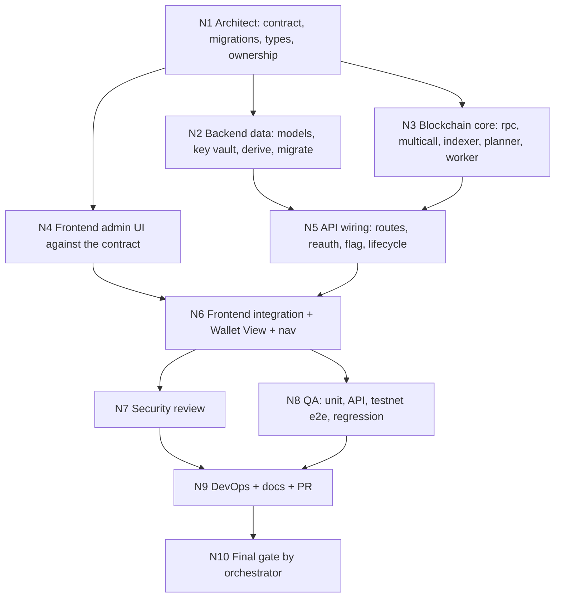

# Managed Wallets — Feature Specification (admin-only)

| | |
|---|---|
| Status | DRAFT v1, ready for build |
| Date | 2026-10-21 |
| Product | HolderForge (this repo) |
| Target branch | `feat/managed-wallets` (never push to `main`; every push to `main` deploys to production) |
| Companion | `docs/MANAGED_WALLETS_PROMPT.md` (the Claude Code orchestrator prompt that builds this spec) |
| Read first | `HANDOFF.md` (system map, conventions, known risks) |

---

## 1. The requirement, restated

What was asked, in plain words:

1. An **admin-only** feature.
2. Create wallets **from one master wallet**, the same way today's "HD single seed" mode derives child wallets from a master mnemonic.
3. The admin hands the generated **addresses** to their people.
4. When anyone sends **any token** (or BNB) to one of those addresses, it lands in that individual address.
5. **Only the master** can move funds out. The address holder can **see** the tokens but has **no ability to send**.
6. **All balances roll up** into one master view ("all balance should be shown in master balance").

What this is in product terms: a **custodial wallet pool**, the same pattern an exchange uses for deposit addresses. One admin-owned seed, many derived deposit addresses, read-only visibility for each holder, custody and outbound control with the admin, and a treasury roll-up.

The business purpose is not fully known ("idk what it is for"). The design below therefore keeps the pool generic: it works for staff sub-accounts, community allocations, client deposit addresses, or internal treasury partitioning without changes.

Feature name used everywhere in code and UI: **Managed Wallets**. The roll-up screen is **Treasury**. The holder-facing page is **Wallet View**.

---

## 2. Assumptions and chosen defaults

Every unknown gets a default so the build can start. Each one is a single switch to change later.

| # | Question | Default chosen | Why | Change later by |
|---|---|---|---|---|
| A1 | Who are "their people" and how do they log in? | They get a **view-only link** per address (unguessable 256-bit token). No account needed. Admin can also record a name and email, and optionally link an existing app user. | Lowest friction; the on-chain data is public anyway, only custody is sensitive. | Phase 2: show "My managed wallets" on the Account page for linked users. |
| A2 | Which networks? | BSC mainnet and BSC testnet, same as the rest of the app. | Reuses existing RPC config. | Add a network to the enum. |
| A3 | Which tokens count? | Native BNB plus **any BEP-20** discovered from on-chain Transfer events, plus an admin-maintained tracked list. Spam tokens can be hidden. | "some token or any token" requires discovery, not a fixed list. | Tracked-only mode via a flag. |
| A4 | Can holders request withdrawals? | No. Holders are strictly read-only. | Not asked; keeps the trust model simple. | Phase 2: request → admin approve → transfer. |
| A5 | Is this a paid plan? | No. Admin-only internal tool, no billing hooks. | Explicitly "admin only". | Gate behind a plan later. |
| A6 | How many wallets per pool? | Up to 10,000 per pool (configurable). | Indexer filters are chunked; derivation is instant. | Raise the env limit. |
| A7 | One master or many? | Many **pools**, each with its own master seed. | Admin may run separate groups or projects. | None needed. |
| A8 | Where is the master wallet? | **Derivation index 0** of the pool seed. Managed wallets start at index 1. | The admin can import the seed into MetaMask and see the master account as account 1. Standard path. | None. |
| A9 | Does this touch the existing distribution wizard? | No. Completely additive, behind a feature flag. | Requirement: do not break the current flow. | Phase 2: let the wizard target a pool as recipients. |
| A10 | Gas for outbound transfers from a child address? | **Automatic gas top-up** from the master wallet, then the child signs. | A deposit address holds tokens but zero BNB; it cannot pay gas by itself. This is the single most important engineering detail of the feature. | Relayer or EIP-7702 delegation in a later phase. |

---

## 3. Glossary

| Term | Meaning |
|---|---|
| Pool | One master seed (BIP-39 mnemonic) plus its network and settings. Owned by an admin. |
| Master wallet | Derivation index 0 of the pool seed. Holds BNB for gas top-ups and receives sweeps by default. |
| Managed wallet | A child address at index ≥ 1 of the pool seed, path `m/44'/60'/0'/0/{i}`. Handed to a holder. |
| Holder | The person who receives a managed address. Read-only. Identified by a label, optional email, optional linked user. |
| View link | `https://holderforge.io/w/{viewToken}`: public, read-only page for one managed wallet. |
| Deposit | An incoming token transfer to a managed wallet, found by the indexer. |
| Transfer job | An admin-requested outbound transfer from a managed wallet, executed by the worker with automatic gas top-up. |
| Sweep | A batch of transfer jobs that moves balances from many managed wallets to the master (or any destination). |
| Treasury | Aggregated balances per token across a pool (or all pools) plus the master wallet balance. |
| Tracked token | A token the admin added explicitly so it is always shown and refreshed. |
| Discovered token | A token first seen by the indexer because it was sent to a managed wallet. |

---

## 4. Team roles (multi-agent) and ownership

Each role is one agent with an **exclusive** file set. No two agents edit the same file. Requests across boundaries go through the orchestrator.

| Role | Responsibilities | Owns (exclusive) | Never touches |
|---|---|---|---|
| R1 Product Manager | This spec, acceptance criteria, scope decisions. Done. | `docs/MANAGED_WALLETS_SPEC.md` | code |
| R2 Solutions Architect | Module map, sequence diagrams, API contract, migration SQL, shared TS types, binding file-ownership list. | `docs/managed-wallets/*`, `backend/migrations/*`, `backend/src/managed/types.ts`, `frontend/src/lib/managedTypes.ts` | routes, pages |
| R3 Backend Engineer (data) | Migration runner, models for all new tables, key vault, derivation helper, audit helper. | `backend/src/migrate.ts`, `backend/src/managed/models/*`, `backend/src/managed/keyVault.ts`, `backend/src/managed/derive.ts`, `backend/src/managed/audit.ts`, `backend/scripts/managed/gen-key.ts` | existing `models/*`, `routes/*` |
| R4 Blockchain Engineer | RPC/multicall helpers, deposit indexer, balance refresher, transfer planner and worker (gas top-up + signing), fee logic. | `backend/src/managed/chain/*` (`rpc.ts`, `multicall.ts`, `indexer.ts`, `balances.ts`, `transferPlanner.ts`, `transferWorker.ts`, `fees.ts`) | models, routes, scripts/*.ts (frozen) |
| R5 Frontend Engineer (admin UI) | Admin pages and components for pools, wallets, treasury, transfers, settings. | `frontend/src/pages/admin/managed/*`, `frontend/src/components/managed/*` | `App.tsx`, `Sidebar.tsx`, wizard pages |
| R6 Frontend Engineer (integration + holder view) | Typed API client, public Wallet View page, route and nav wiring, QR component. | `frontend/src/lib/managedApi.ts`, `frontend/src/pages/WalletViewPage.tsx`, `frontend/src/components/managed/QrCode.tsx`, and the allowed edits to `App.tsx`, `Sidebar.tsx`, `AdminLayout.tsx` | admin pages (R5) |
| R7 API Engineer (wiring) | Express routers, re-auth middleware, feature flag, rate limiter, lifecycle hooks in `index.ts`, session typing. | `backend/src/managed/routes/*`, `backend/src/managed/index.ts`, `backend/src/managed/middleware/*`, `backend/src/lib/password.ts`, and the allowed edits to `backend/src/index.ts`, `backend/src/routes/auth.ts`, `backend/src/types/express.d.ts` | scripts, runner, other routes |
| R8 Security Reviewer | Threat model, key-handling audit, authz tests, findings list with severity. Read-only on code; fixes go back to owners. | `docs/managed-wallets/SECURITY_REVIEW.md` | all code |
| R9 QA Engineer | Unit tests, API tests, testnet end-to-end script, regression checklist of the existing wizard. | `backend/test/managed/*`, `backend/scripts/managed/testnet-e2e.ts`, `backend/vitest.config.ts`, `docs/managed-wallets/TEST_PLAN.md` | feature code |
| R10 DevOps + Tech Writer | Env vars, `.env.example`, k8s secret instructions, migration runbook, deploy checklist, PR description. | `backend/.env.example`, `docs/managed-wallets/RUNBOOK.md`, `docs/managed-wallets/PR_DESCRIPTION.md`, `README` additions | k8s manifests (no change needed), CI workflow |

Allowed edits to existing files are enumerated in §7. Everything else existing is frozen.

---

## 5. UI features, names, flows, and owners

### 5.1 Feature map

| # | UI feature name | Route | Purpose | Owner | Depends on |
|---|---|---|---|---|---|
| F1 | **Pools** | `/admin/managed` | List pools; create a pool (generate or import seed); archive. | R5 | API pools |
| F2 | **Pool Detail › Wallets** | `/admin/managed/pools/:poolId` (tab Wallets) | Generate N managed wallets; table with label, holder, balances, last deposit; assign; copy view link; transfer; sweep. | R5 | API wallets, balances |
| F3 | **Pool Detail › Deposits** | same page, tab Deposits | Chronological incoming transfers with tx links, token, amount, from. | R5 | Indexer |
| F4 | **Pool Detail › Transfers** | same page, tab Transfers | Jobs for this pool with live status and both tx hashes. | R5 | Worker |
| F5 | **Pool Detail › Settings** | same page, tab Settings | Rename, reveal seed (re-auth), archive, export CSV (addresses only). | R5 | API |
| F6 | **Treasury** | `/admin/treasury` | Totals per token across all pools and per pool; master wallet balances; deposit feed; low-gas warning for master. | R5 | Balances |
| F7 | **Transfer dialog** | modal from F2/F6 | 3-step: asset → amount and destination → review (shows gas top-up if needed) → password re-auth → submit → live job drawer. | R5 | Planner, worker |
| F8 | **Sweep dialog** | modal from F2 | Choose wallets (all or selected) and assets (all discovered or chosen); review count and estimated gas; re-auth; batch progress. | R5 | Planner, worker |
| F9 | **Transfer Jobs** | `/admin/managed/transfers` | All jobs across pools, filters by status and batch, retry failed. | R5 | Worker |
| F10 | **Tokens & Indexer** | `/admin/managed/settings` | Tracked tokens per network, hide spam tokens, indexer status (last block, lag, errors), run now, key-vault health. | R5 | Indexer |
| F11 | **Wallet View** (holder) | `/w/:viewToken` (public, no login) | Address, QR, network, BNB balance, token balances, recent deposits, refresh. **No send controls of any kind.** | R6 | Public API |
| F12 | **Navigation** | Sidebar + Admin tabs | "Managed" and "Treasury" entries, visible only to ADMIN and only when the backend reports the feature enabled. | R6 | Health endpoint |

### 5.2 Flows

**Flow 1, create a pool (F1).** Pools → "New pool" → form: name, network, seed source (Generate 12 words, or Import existing phrase) → password re-auth → pool created, master address shown → one-time "Save your recovery phrase" modal (reveal, copy, checkbox "I stored it") → lands on Pool Detail. Audit: `POOL_CREATED`, `MNEMONIC_REVEALED`.

**Flow 2, generate managed wallets (F2).** Pool Detail → "Generate wallets" → count (1 to remaining limit), optional label prefix → server derives indexes `next_index … next_index+count-1`, inserts rows, advances `next_index` atomically → table refreshes. No private keys are written anywhere. Audit: `WALLETS_GENERATED {count, fromIndex, toIndex}`.

**Flow 3, assign and share (F2).** Row → "Assign" → label, holder name, email, optional existing user by email → save. Row → "Copy view link". Row → "Rotate link" invalidates the old token. Audit: `WALLET_ASSIGNED`, `VIEW_TOKEN_ROTATED`.

**Flow 4, deposits arrive (F3, F6, F11).** Anyone sends BNB or a BEP-20 to a managed address → indexer finds the Transfer log within the next cycle → token metadata discovered on first sight → deposit row inserted → balance refreshed → Deposits tab, wallet row chips, Treasury totals, and Wallet View all update.

**Flow 5, admin transfer (F7).** Row → "Transfer" → step 1 pick asset (BNB or any token with a balance) → step 2 amount with Max, destination (default master) → step 3 review: estimated gas, child BNB balance, and if insufficient the line "Gas top-up from master: X BNB" → password re-auth → submit → job drawer polls status `PENDING → FUNDING_GAS → SENDING → CONFIRMED` with BscScan links for both transactions. Audit: `TRANSFER_REQUESTED`, `TRANSFER_CONFIRMED` or `TRANSFER_FAILED`.

**Flow 6, sweep to master (F8).** Pool Detail → "Sweep" → wallets: all with a balance, or selected → assets: all discovered, or chosen → review: number of jobs, estimated total gas, master BNB available → re-auth → one batch id, one job per (wallet, asset) → batch progress page with per-job status; failures isolated. Audit: `SWEEP_REQUESTED {batchId, jobs}`.

**Flow 7, holder opens the link (F11).** Opens `/w/{token}` → page shows label, address with copy and QR, network badge, BNB balance, token list (symbol, amount, hidden tokens excluded), last 50 deposits with tx links, "Updated X ago", refresh button, "Powered by HolderForge". Nothing else: no pool name, no index, no other addresses, no send.

**Flow 8, operations (F10).** Admin adds a tracked token by address → metadata fetched → appears in balances for all wallets of that network. Admin hides a spam token → removed from all views and treasury totals. Admin sees indexer lag and can trigger a run.

---

## 6. Architecture

### 6.1 Fit with the existing system

Reused as-is: Express app, Passport session, `requireAdmin`, Postgres pool, model conventions (hand-written SQL with `mapX` functions), RPC env vars, React Query + axios client pattern, Tailwind theme tokens and `dash-card` classes, `StatCard`, `AddressCell`, `TxHashLink`, `StatusBadge`, `AdminLayout` tabs.

Not reused on purpose: `scripts/generate-wallets.ts` (it writes private keys to disk), `lib/runner.ts` (child processes and stdout regexes are the wrong tool for in-process signing), `output/` folder (global, unsafe). The feature derives keys in memory and keeps all state in Postgres.

Everything new lives under `backend/src/managed/` and `frontend/src/pages/admin/managed/` plus `frontend/src/components/managed/`, mounted only when `MANAGED_WALLETS_ENABLED=true`.

### 6.2 Data model (Postgres)

The repo has no schema files today. The Architect first introspects the live schema read-only (`information_schema.columns` for `users`) to match the id type of `users.id` (UUID or TEXT) and writes `backend/migrations/0000_baseline.sql` as documentation of existing tables, then `0001_managed_wallets.sql` below. A tiny runner `backend/src/migrate.ts` applies `migrations/*.sql` in order and records them in `schema_migrations`. All statements are idempotent.

```sql
CREATE TABLE IF NOT EXISTS schema_migrations (
  name        TEXT PRIMARY KEY,
  applied_at  TIMESTAMPTZ NOT NULL DEFAULT NOW()
);

CREATE TABLE IF NOT EXISTS managed_pools (
  id                   UUID PRIMARY KEY,
  owner_user_id        TEXT NOT NULL,                -- match users.id type exactly
  name                 TEXT NOT NULL,
  network              TEXT NOT NULL CHECK (network IN ('bscMainnet','bscTestnet')),
  account_path         TEXT NOT NULL DEFAULT 'm/44''/60''/0''/0',
  master_address       TEXT NOT NULL,                -- derivation index 0, checksummed
  mnemonic_ciphertext  TEXT NOT NULL,                -- base64, AES-256-GCM
  mnemonic_iv          TEXT NOT NULL,                -- base64, 12 bytes
  mnemonic_tag         TEXT NOT NULL,                -- base64, 16 bytes
  key_version          INT  NOT NULL DEFAULT 1,
  next_index           INT  NOT NULL DEFAULT 1,      -- index 0 is the master
  status               TEXT NOT NULL DEFAULT 'ACTIVE' CHECK (status IN ('ACTIVE','ARCHIVED')),
  mnemonic_revealed_at TIMESTAMPTZ,
  created_at           TIMESTAMPTZ NOT NULL DEFAULT NOW(),
  updated_at           TIMESTAMPTZ NOT NULL DEFAULT NOW()
);

CREATE TABLE IF NOT EXISTS managed_wallets (
  id                UUID PRIMARY KEY,
  pool_id           UUID NOT NULL REFERENCES managed_pools(id) ON DELETE CASCADE,
  derivation_index  INT  NOT NULL CHECK (derivation_index >= 1),
  address           TEXT NOT NULL,                   -- checksummed
  label             TEXT,
  holder_name       TEXT,
  holder_email      TEXT,
  holder_user_id    TEXT,                            -- optional link to users.id
  view_token        TEXT NOT NULL,                   -- 32 random bytes, hex
  status            TEXT NOT NULL DEFAULT 'ACTIVE' CHECK (status IN ('ACTIVE','DISABLED')),
  created_at        TIMESTAMPTZ NOT NULL DEFAULT NOW(),
  updated_at        TIMESTAMPTZ NOT NULL DEFAULT NOW(),
  UNIQUE (pool_id, derivation_index),
  UNIQUE (address),
  UNIQUE (view_token)
);

CREATE TABLE IF NOT EXISTS managed_tokens (
  id             UUID PRIMARY KEY,
  network        TEXT NOT NULL,
  token_address  TEXT NOT NULL,                      -- lowercase
  symbol         TEXT NOT NULL DEFAULT 'UNKNOWN',
  name           TEXT NOT NULL DEFAULT 'Unknown token',
  decimals       INT  NOT NULL DEFAULT 18,
  source         TEXT NOT NULL CHECK (source IN ('TRACKED','DISCOVERED')),
  hidden         BOOLEAN NOT NULL DEFAULT FALSE,     -- spam filter
  first_seen_block BIGINT,
  created_at     TIMESTAMPTZ NOT NULL DEFAULT NOW(),
  UNIQUE (network, token_address)
);

-- asset = 'native' for BNB, else lowercase token address
CREATE TABLE IF NOT EXISTS managed_balances (
  wallet_id     UUID NOT NULL REFERENCES managed_wallets(id) ON DELETE CASCADE,
  asset         TEXT NOT NULL,
  balance_wei   NUMERIC(78,0) NOT NULL DEFAULT 0,
  block_number  BIGINT,
  updated_at    TIMESTAMPTZ NOT NULL DEFAULT NOW(),
  PRIMARY KEY (wallet_id, asset)
);

-- master balances are stored with wallet_id NULL via a separate small table
CREATE TABLE IF NOT EXISTS managed_master_balances (
  pool_id       UUID NOT NULL REFERENCES managed_pools(id) ON DELETE CASCADE,
  asset         TEXT NOT NULL,
  balance_wei   NUMERIC(78,0) NOT NULL DEFAULT 0,
  block_number  BIGINT,
  updated_at    TIMESTAMPTZ NOT NULL DEFAULT NOW(),
  PRIMARY KEY (pool_id, asset)
);

CREATE TABLE IF NOT EXISTS managed_deposits (
  id            UUID PRIMARY KEY,
  wallet_id     UUID NOT NULL REFERENCES managed_wallets(id) ON DELETE CASCADE,
  asset         TEXT NOT NULL,                       -- token address (native deposits are not itemized in v1)
  from_address  TEXT NOT NULL,
  amount_wei    NUMERIC(78,0) NOT NULL,
  tx_hash       TEXT NOT NULL,
  log_index     INT  NOT NULL,
  block_number  BIGINT NOT NULL,
  block_time    TIMESTAMPTZ,
  created_at    TIMESTAMPTZ NOT NULL DEFAULT NOW(),
  UNIQUE (tx_hash, log_index)
);
CREATE INDEX IF NOT EXISTS managed_deposits_wallet_idx ON managed_deposits (wallet_id, block_number DESC);

CREATE TABLE IF NOT EXISTS managed_transfers (
  id                 UUID PRIMARY KEY,
  pool_id            UUID NOT NULL REFERENCES managed_pools(id) ON DELETE CASCADE,
  wallet_id          UUID NOT NULL REFERENCES managed_wallets(id) ON DELETE CASCADE,
  batch_id           UUID,                           -- set for sweeps
  to_address         TEXT NOT NULL,
  asset              TEXT NOT NULL,                  -- 'native' or token address
  amount_wei         NUMERIC(78,0) NOT NULL,         -- 0 with sweep_all = true means "all"
  sweep_all          BOOLEAN NOT NULL DEFAULT FALSE,
  status             TEXT NOT NULL DEFAULT 'PENDING'
                     CHECK (status IN ('PENDING','FUNDING_GAS','SENDING','CONFIRMED','FAILED','CANCELLED')),
  gas_topup_tx_hash  TEXT,
  transfer_tx_hash   TEXT,
  gas_price_wei      NUMERIC(78,0),
  gas_limit          BIGINT,
  error              TEXT,
  attempts           INT NOT NULL DEFAULT 0,
  idempotency_key    TEXT NOT NULL UNIQUE,
  requested_by       TEXT NOT NULL,                  -- users.id
  created_at         TIMESTAMPTZ NOT NULL DEFAULT NOW(),
  updated_at         TIMESTAMPTZ NOT NULL DEFAULT NOW(),
  confirmed_at       TIMESTAMPTZ
);
CREATE INDEX IF NOT EXISTS managed_transfers_status_idx ON managed_transfers (status, created_at);
CREATE INDEX IF NOT EXISTS managed_transfers_batch_idx  ON managed_transfers (batch_id);

CREATE TABLE IF NOT EXISTS managed_indexer_state (
  network             TEXT PRIMARY KEY,
  last_scanned_block  BIGINT NOT NULL DEFAULT 0,
  last_run_at         TIMESTAMPTZ,
  last_error          TEXT,
  updated_at          TIMESTAMPTZ NOT NULL DEFAULT NOW()
);

CREATE TABLE IF NOT EXISTS managed_audits (
  id          UUID PRIMARY KEY,
  user_id     TEXT NOT NULL,
  pool_id     UUID,
  wallet_id   UUID,
  action      TEXT NOT NULL,
  details     JSONB NOT NULL DEFAULT '{}'::jsonb,
  created_at  TIMESTAMPTZ NOT NULL DEFAULT NOW()
);
CREATE INDEX IF NOT EXISTS managed_audits_pool_idx ON managed_audits (pool_id, created_at DESC);
```

### 6.3 Key custody and signing

- `WALLET_ENCRYPTION_KEY`: base64 of 32 random bytes, provided by env (k8s secret). `backend/scripts/managed/gen-key.ts` prints a new one. If the key is missing while the feature is enabled, the API answers `503 { code: "KEY_VAULT_UNAVAILABLE" }` for every managed route and the app otherwise runs normally.
- `keyVault.ts`: `encryptSecret(plaintext) → { ciphertext, iv, tag, keyVersion }` and `decryptSecret(...)`, AES-256-GCM via Node `crypto`, with the pool id as additional authenticated data so a ciphertext cannot be moved between pools.
- `derive.ts`: `accountNode(mnemonic) = HDNodeWallet.fromPhrase(mnemonic, undefined, "m/44'/60'/0'/0")`, `masterSigner = accountNode.deriveChild(0)`, `childSigner(i) = accountNode.deriveChild(i)`. Identical to the fixed path in `scripts/generate-wallets.ts`, so a seed imported into MetaMask shows the master as its first account.
- The mnemonic is decrypted only inside the transfer worker and the reveal endpoint, held in a local variable, never assigned to a logger, request, or file. Child private keys are never persisted.
- Sensitive endpoints (create pool, reveal seed, transfer, sweep, rotate link) require **password re-authentication** within the last 10 minutes: `POST /api/admin/managed/reauth { password }` verifies against the user's stored PBKDF2 hash and stamps `req.session.managedReauthAt`. The hashing function is extracted from `routes/auth.ts` into `lib/password.ts` without behavior change so both routes share it.

### 6.4 Deposit indexer (the "graph" decision)

Two readings of "graph engineering" were considered. Both are addressed.

**On-chain indexing choice.** Detecting "someone sent any token to one of our addresses" is an indexing problem. Options:

| Option | Verdict for v1 |
|---|---|
| The Graph subgraph | Not for v1. A subgraph cannot filter by a dynamic, growing address set without indexing every ERC-20 transfer on BSC. High operational cost, external dependency, and a second deployment pipeline. Kept open behind the `BalanceSource` interface for later. |
| Provider token APIs (Alchemy token balances, BscScan) | Optional adapter later. Vendor lock and per-network coverage differ. |
| **Self-hosted log scanner over the existing RPCs** | **Chosen.** Small, deterministic, no new infrastructure, and the address set is ours. |

Design of the scanner (`chain/indexer.ts`):

- Runs in-process on a timer (`MANAGED_INDEXER_INTERVAL_MS`, default 30000) when `MANAGED_INDEXER_ENABLED=true`. Single replica is already a system invariant (see HANDOFF §3).
- Per network with at least one ACTIVE pool: `head = latestBlock - MANAGED_INDEXER_CONFIRMATIONS` (default 15). Scan `[last_scanned_block + 1, head]` in chunks of `MANAGED_INDEXER_BLOCK_CHUNK` (default 1000).
- Filter: `topics = [TRANSFER_SIG, null, [paddedManagedAddress...]]` where `TRANSFER_SIG = 0xddf252ad1be2c89b69c2b068fc378daa952ba7f163c4a11628f55a4df523b3ef`. Addresses are OR-listed in topic position 2 (the `to` field) in groups of `MANAGED_INDEXER_ADDRESS_CHUNK` (default 500) to stay under provider payload limits.
- For each log: upsert `managed_tokens` (fetch `symbol`, `name`, `decimals` once with try/catch and sane fallbacks), insert `managed_deposits` (unique on `tx_hash, log_index` makes re-scans safe), and mark `(wallet, asset)` dirty.
- After the scan: refresh dirty balances immediately; refresh **all** balances every `MANAGED_FULL_REFRESH_MS` (default 600000) so manual movements made outside the app (for example from MetaMask with the imported seed) are reflected.
- Balance reads use **Multicall3** at `0xcA11bde05977b3631167028862bE2a173976CA11` (same address on BSC mainnet and testnet): `getEthBalance` for BNB and `aggregate3` of `balanceOf` calls, ~500 per round trip, with a per-call fallback if multicall fails.
- Reorg safety comes from the confirmation lag. Native BNB deposits have no event, so they appear as balance changes (not itemized) in v1; this is stated in the UI.
- Backoff on RPC errors (429, timeouts), rotating to `FALLBACK_RPC_1/2` for reads, and recording `last_error` for the Settings page.

**Build orchestration choice.** The multi-agent build itself is a dependency graph; see §8.

### 6.5 Transfer and sweep engine (automatic gas top-up)

`chain/transferPlanner.ts` (pure, unit-tested) and `chain/transferWorker.ts` (effects).

Planner input: child address, asset, requested amount or sweep-all, destination, current child BNB balance, current token balance, fee data. Output: an ordered plan with zero, one, or two transactions and the exact top-up amount, or a typed rejection.

1. Build the transfer: native → `{ to, value }`; token → `{ to: token, data: transfer(to, amount) }`.
2. Estimate gas from the child address, multiply by 1.2, cap by `MANAGED_MAX_GAS_LIMIT` (default 300000). Gas price from `provider.getFeeData()` with a floor `MANAGED_MIN_GAS_PRICE_GWEI` (default 0.1) and a ceiling env. The existing 0.05 gwei hard-code in `scripts/distribute.ts` is untouched and out of scope.
3. `gasCost = gasLimit × gasPrice`.
   - Token transfer: if `childBnb < gasCost` then `topUp = gasCost − childBnb + MANAGED_TOPUP_BUFFER_WEI`.
   - Native transfer: amount must satisfy `amount + gasCost ≤ childBnb`; sweep-all native sets `amount = childBnb − gasCost`; no top-up is ever sent for native (it would be circular). If `childBnb ≤ gasCost` the job fails with `NOTHING_TO_SWEEP`.
4. If `topUp > 0`: verify `masterBnb ≥ topUp + reserve`, else fail with `MASTER_INSUFFICIENT_BNB` (shown in the review step before the job is even created).

Worker (`transferWorker.ts`), single global loop, concurrency 1, started only when the feature is enabled:

- Picks the oldest `PENDING` job with `SELECT … FOR UPDATE SKIP LOCKED`, sets `attempts += 1`.
- Decrypts the pool seed, derives master and child signers (in memory only).
- If the plan has a top-up: status `FUNDING_GAS`, master sends BNB to the child, waits for 1 confirmation, stores `gas_topup_tx_hash`. Master nonces are serialized by the loop itself (one job at a time), which is why concurrency stays 1 in v1.
- Status `SENDING`: child signs and broadcasts, waits for 1 confirmation, stores `transfer_tx_hash`, status `CONFIRMED`, refreshes balances for the child, destination, and master.
- Idempotency: before any broadcast the worker checks whether a stored hash already has a receipt (restart safety). Failures set `FAILED` with a typed error; retries are explicit via the API and respect `MANAGED_MAX_ATTEMPTS` (default 3). A tx pending longer than `MANAGED_TX_TIMEOUT_MS` is marked `FAILED` with `TIMEOUT` while keeping its hash for inspection.
- Sweeps create one job per (wallet, asset) under a shared `batch_id`; the batch endpoint reports counts by status.

Phase 2 note: parallelize child transfers (each child has its own nonce) while serializing only master top-ups through a `SerialTxSubmitter` like the one in `scripts/distribute.ts`.

### 6.6 API contract

All admin routes: prefix `/api/admin/managed`, guards `requireAdmin` → feature flag → key-vault check. Sensitive routes additionally require `requireRecentReauth`. Errors use `{ error, code }`.

| Method | Path | Guard | Body / query → response |
|---|---|---|---|
| GET | `/health` | admin | `{ enabled, keyVault: "ok"\|"missing", migrated, indexer: { enabled, lastBlockByNetwork } }` |
| POST | `/reauth` | admin | `{ password }` → `{ ok, validUntil }` |
| GET | `/pools` | admin | → `{ pools: [{ id, name, network, masterAddress, walletCount, status, createdAt }] }` |
| POST | `/pools` | admin + reauth | `{ name, network, mnemonic? }` → `{ pool, masterAddress }` (mnemonic never echoed) |
| GET | `/pools/:id` | admin | → `{ pool, stats: { wallets, assetsTracked, lastDepositAt } }` |
| PATCH | `/pools/:id` | admin | `{ name?, status? }` → `{ pool }` |
| POST | `/pools/:id/reveal-mnemonic` | admin + reauth | → `{ mnemonic }` once per request; audited |
| POST | `/pools/:id/wallets/generate` | admin | `{ count, labelPrefix? }` → `{ created: [{ id, derivationIndex, address }] }` |
| GET | `/pools/:id/wallets` | admin | `?skip&limit&search` → `{ wallets: [{ …wallet, balances: [{ asset, symbol, decimals, balance }] , lastDepositAt }], total }` |
| GET | `/wallets/:id` | admin | → `{ wallet, balances, deposits (last 50), transfers (last 50) }` |
| PATCH | `/wallets/:id` | admin | `{ label?, holderName?, holderEmail?, holderUserEmail?, status? }` → `{ wallet }` |
| POST | `/wallets/:id/rotate-view-token` | admin + reauth | → `{ viewToken }` |
| GET | `/pools/:id/deposits` | admin | `?skip&limit&asset` → `{ deposits, total }` |
| GET | `/pools/:id/treasury` | admin | → `{ totals: [{ asset, symbol, decimals, total }], master: [{ asset, balance }], walletCount, lowGas: boolean }` |
| GET | `/treasury` | admin | → same shape aggregated across pools plus `byPool[]` |
| POST | `/transfers/plan` | admin | `{ walletId, toAddress, asset, amount?\|sweepAll }` → `{ plan: { gasLimit, gasPriceWei, gasCostWei, topUpWei, masterBnbWei, ok, reason? } }` (dry run for the review step) |
| POST | `/transfers` | admin + reauth | `{ walletId, toAddress, asset, amount?\|sweepAll, idempotencyKey }` → `{ job }` |
| POST | `/transfers/sweep` | admin + reauth | `{ poolId, walletIds: string[]\|"ALL", assets: string[]\|"ALL", toAddress?, idempotencyKey }` → `{ batchId, jobs: number, skipped: number }` |
| GET | `/transfers` | admin | `?poolId&batchId&status&skip&limit` → `{ jobs, total, byStatus }` |
| GET | `/transfers/:id` | admin | → `{ job }` |
| POST | `/transfers/:id/retry` | admin + reauth | → `{ job }` |
| GET | `/tokens` | admin | `?network` → `{ tokens }` |
| POST | `/tokens` | admin | `{ network, tokenAddress }` → `{ token }` (metadata fetched on-chain) |
| PATCH | `/tokens/:id` | admin | `{ hidden }` → `{ token }` |
| GET | `/indexer/status` | admin | → `{ byNetwork: [{ network, lastScannedBlock, head, lag, lastRunAt, lastError }] }` |
| POST | `/indexer/run` | admin | → `{ started: true }` |
| GET | `/export/pools/:id.csv` | admin | CSV: index, address, label, holder, balances. **No keys.** |

Public route, prefix `/api/view`, no auth, rate limited (`express-rate-limit`, 60 requests per minute per IP):

| GET | `/api/view/:viewToken` | → `{ label, address, network, native: { symbol, balance }, tokens: [{ symbol, name, decimals, balance, tokenAddress }], deposits: [{ txHash, asset, symbol, amount, from, blockTime }], updatedAt }` or `404`. Never includes pool, index, or other wallets. |

### 6.7 Frontend structure

```
frontend/src/
  lib/managedApi.ts                 typed client over the existing axios instance
  lib/managedTypes.ts               shared payload types (mirrors backend/src/managed/types.ts)
  pages/admin/managed/
    PoolsPage.tsx                   F1
    PoolDetailPage.tsx              F2–F5 (tabs)
    TreasuryPage.tsx                F6
    TransferJobsPage.tsx            F9
    ManagedSettingsPage.tsx         F10
  pages/WalletViewPage.tsx          F11 (standalone layout like PaymentResult, no Shell)
  components/managed/
    PoolCard.tsx, ManagedWalletTable.tsx, BalanceChips.tsx, TokenBadge.tsx,
    TransferDialog.tsx (F7), SweepDialog.tsx (F8), JobStatusDrawer.tsx,
    ReauthDialog.tsx, ViewLinkButton.tsx, DepositFeed.tsx, IndexerStatusBadge.tsx,
    RevealMnemonicModal.tsx, QrCode.tsx
```

Routing (allowed edit in `App.tsx`): nested under the existing `/admin` `ProtectedRoute requireAdmin` → `managed`, `managed/pools/:poolId`, `managed/transfers`, `managed/settings`, `treasury`; and a top-level public `/w/:viewToken`. Navigation (allowed edits in `Sidebar.tsx` and `AdminLayout.tsx`): entries appear only for ADMIN and only after `GET /api/admin/managed/health` returns `enabled: true` (a 404 means disabled and hides them).

Visual language: reuse theme tokens, `dash-card`, `StatCard`, `AddressCell`, `TxHashLink`, `StatusBadge`, lucide icons, React Query with `refetchInterval` for live status (5 s while a job is active, 30 s otherwise).

### 6.8 Configuration

New env vars (all added to `backend/.env.example` with comments):

```
MANAGED_WALLETS_ENABLED=false          # master switch; off = app identical to today
WALLET_ENCRYPTION_KEY=                 # base64 32 bytes; npm run managed:gen-key
MANAGED_INDEXER_ENABLED=true           # run the deposit scanner in this process
MANAGED_WORKER_ENABLED=true            # run the transfer worker in this process (false on a laptop that shares the production DB)
MANAGED_INDEXER_INTERVAL_MS=30000
MANAGED_INDEXER_CONFIRMATIONS=15
MANAGED_INDEXER_BLOCK_CHUNK=1000
MANAGED_INDEXER_ADDRESS_CHUNK=500
MANAGED_FULL_REFRESH_MS=600000
MANAGED_MAX_WALLETS_PER_POOL=10000
MANAGED_MIN_GAS_PRICE_GWEI=0.1
MANAGED_MAX_GAS_PRICE_GWEI=5
MANAGED_MAX_GAS_LIMIT=300000
MANAGED_TOPUP_BUFFER_WEI=100000000000000   # 0.0001 BNB
MANAGED_MAX_ATTEMPTS=3
MANAGED_TX_TIMEOUT_MS=180000
MANAGED_VIEW_RATE_LIMIT_PER_MIN=60
MULTICALL3_ADDRESS=0xcA11bde05977b3631167028862bE2a173976CA11
```

Production: add the vars to the k8s secret `holderforge-backend-env` (created manually on the server), run the migration inside the pod, then flip `MANAGED_WALLETS_ENABLED=true` and restart. Order matters and is written in the runbook.

### 6.9 Observability and audit

- Every state change writes a `managed_audits` row with the acting admin, pool, wallet, action, and non-secret details.
- Logs use the prefix `[managed]`; a redaction helper guarantees no mnemonic, private key, or ciphertext ever reaches a log line (unit tested).
- `GET /health` for the whole app is unchanged.

---

## 7. Non-breaking rules

**Frozen (no edits at all):** `backend/scripts/*`, `backend/contracts/*`, `backend/src/lib/runner.ts`, `backend/src/lib/plans.ts`, `backend/src/lib/distributionBatching.ts`, `backend/src/models/*` (existing files), `backend/src/routes/*` except `auth.ts` as below, `backend/src/middleware/*`, `backend/src/config/*`, `frontend/src/shared/plans.ts`, `frontend/src/lib/distributionBatching.ts`, `frontend/src/pages/{Setup,Generate,Plan,Distribute,Results,History}Page.tsx`, `frontend/src/components/ui/*`, `frontend/src/components/layout/TopBar.tsx`, `k8s/*`, `.github/workflows/*`, both `Dockerfile`s.

**Allowed edits to existing files (exact scope):**

| File | Allowed change |
|---|---|
| `backend/src/index.ts` | Import `mountManagedWallets`/`startManagedWorkers`/`stopManagedWorkers` from `./managed`; call mount after the existing routers and before the 404 handler, guarded by the flag; start workers in `start()` after listen; stop them inside `shutdown()`. Nothing else moves. The webhook route stays before `express.json()`. |
| `backend/src/routes/auth.ts` | Replace the local `hashPassword` body with an import from `../lib/password` (identical algorithm: PBKDF2-SHA512, 100000 iterations, 64 bytes, hex). |
| `backend/src/types/express.d.ts` | Additive `declare module "express-session" { interface SessionData { managedReauthAt?: number } }`. |
| `backend/package.json` | Add scripts `migrate`, `managed:gen-key`, `test`; add dev deps `vitest`, `supertest`, `@types/supertest`; add dep `express-rate-limit`. |
| `backend/tsconfig.json` | Only if needed to include `migrations`/`test` globs; `tsconfig.build.json` keeps `rootDir: src`. |
| `backend/.env.example` | Append the §6.8 block plus the already-missing vars noted in HANDOFF §5. |
| `frontend/src/App.tsx` | Add the routes listed in §6.7. |
| `frontend/src/components/layout/Sidebar.tsx` | Add "MANAGED" and "TREASURY" nav entries for ADMIN when enabled. |
| `frontend/src/pages/admin/AdminLayout.tsx` | Add tabs "Managed", "Treasury". |
| `frontend/package.json` | Add dep `qrcode` and `@types/qrcode`. |

**Behavioral invariants:** with `MANAGED_WALLETS_ENABLED=false` the HTTP surface, logs, and UI are unchanged; existing typechecks and builds stay green; no existing env var changes meaning; no existing table is altered.

---

## 8. Build graph (multi-agent execution plan)

Nodes are agents with exclusive files (§4). Nodes in the same group run in parallel. A node starts only when all of its dependencies are complete and the gate after the previous group is green.



| Node | Role | Group | Depends on | Key outputs | Gate to pass |
|---|---|---|---|---|---|
| N1 | R2 | G0 | spec | `docs/managed-wallets/ARCHITECTURE.md`, `API.md`, `FILE_OWNERSHIP.md`, `backend/migrations/0000_baseline.sql`, `0001_managed_wallets.sql`, `backend/src/managed/types.ts`, `frontend/src/lib/managedTypes.ts` | both `tsc` green; migration applied cleanly to a throwaway DB if Docker is available |
| N2 | R3 | G1 | N1 | `migrate.ts`, models, `keyVault.ts`, `derive.ts`, `audit.ts`, `gen-key.ts` | `tsc`; unit tests for vault and derive (known-mnemonic vectors) |
| N3 | R4 | G1 | N1 | `chain/*` with planner unit tests and log-decoding fixtures | `tsc`; planner tests |
| N4 | R5 | G1 | N1 | admin pages and components compiled against `managedTypes.ts` with a mock client | frontend `tsc` |
| N5 | R7 | G2 | N2, N3 | routers, middleware, `managed/index.ts`, `lib/password.ts`, allowed edits to `index.ts`, `auth.ts`, `express.d.ts` | `tsc`; app boots with flag off and on; API tests for guards |
| N6 | R6 | G3 | N4, N5 | `managedApi.ts`, `WalletViewPage.tsx`, `QrCode.tsx`, route and nav edits | frontend `tsc` + `npm run build`; manual smoke against local backend |
| N7 | R8 | G4 | N6 | `SECURITY_REVIEW.md` with findings and severities; fixes routed to owners and re-verified | zero open High findings |
| N8 | R9 | G4 | N6 | `backend/test/managed/*`, `testnet-e2e.ts`, `TEST_PLAN.md` with regression checklist executed | `npm test` green; regression checklist complete |
| N9 | R10 | G5 | N7, N8 | `.env.example`, `RUNBOOK.md`, `PR_DESCRIPTION.md`, README section | docs reviewed by orchestrator |
| N10 | orchestrator | G6 | N9 | final `tsc` both, `npm run build` both, `npm test`, flag-off regression, commit, summary | all green, branch ready for PR |

---

## 9. Acceptance criteria

Numbered so QA can tick them.

1. Admin creates a pool on bscTestnet. The master address equals account 1 shown by MetaMask after importing the revealed phrase.
2. Admin generates 100 managed wallets. Addresses equal `deriveChild(i)` of the standard path for i = 1…100. No private key or plaintext mnemonic exists in the database, on disk, in logs, or in any API response other than the reveal endpoint.
3. Sending tBNB and a test BEP-20 (deploy `ABCToken` with the existing `deploy:token` script) to a managed address shows the token deposit in Deposits, the wallet row, Treasury totals, and the holder's Wallet View within two indexer cycles. The BNB shows as a balance change.
4. Wallet View works logged out, shows balances and deposits, exposes no send control, and reveals no pool name, index, or other addresses. Guessing tokens is infeasible (256-bit) and the route is rate limited.
5. Transferring the token from a managed wallet that holds zero BNB to the master: the review step shows the top-up amount; after confirm the job passes `FUNDING_GAS → SENDING → CONFIRMED`, both hashes are stored and linked, and balances refresh.
6. Sweeping 10 wallets creates 10 jobs under one batch; one deliberately failing job (for example destination contract that reverts) does not block the others.
7. Non-admin users receive 403 on every `/api/admin/managed/*` route; with the flag off they receive 404 and the nav shows nothing.
8. With the flag off, the existing wizard (Setup → Generate → Plan → Distribute → Results on bscTestnet) behaves exactly as before, and both typechecks and builds are green.
9. Killing the backend while a job is `SENDING` and restarting: the worker checks the stored hash, finds the receipt, and marks the job `CONFIRMED` without re-broadcasting.
10. Every admin action above appears in `managed_audits` with the acting user id.

---

## 10. Risks and mitigations

| Risk | Mitigation |
|---|---|
| Loss of `WALLET_ENCRYPTION_KEY` makes every pool unrecoverable | Runbook mandates storing the key and each revealed phrase offline before generating wallets; health endpoint reports key status. |
| Master nonce collisions during sweeps | Single worker loop, one job at a time in v1. |
| RPC rate limits while scanning logs | Chunked block and address ranges, backoff, fallback RPC rotation, lag shown in UI. |
| Spam or malicious tokens flooding views | `hidden` flag per token, discovered tokens default visible but can be hidden in one click. |
| Pod restart mid-transfer | Durable job rows, receipt check before any re-broadcast, idempotency keys. |
| Auto-deploy of `main` | Feature branch only; flag defaults off; migration before enabling. |
| BSC gas price floor changes | Dynamic fee data with configurable floor and ceiling. |
| Native deposit history not itemized | Stated in UI; Phase 2 can use trace APIs or an explorer API. |

---

## 11. Phase 2 backlog (not in this build)

- Holder login: show linked managed wallets on the Account page.
- Withdrawal requests with admin approval.
- Parallel child transfers with serialized master top-ups.
- Itemized native BNB deposits via trace or explorer APIs.
- Use a pool as the recipient set for the existing distribution wizard.
- Subgraph or provider token API adapter behind `BalanceSource`.
- Key rotation tooling using `key_version`.
- Optional EIP-7702 or relayer-based gas sponsorship to remove the top-up transaction.
