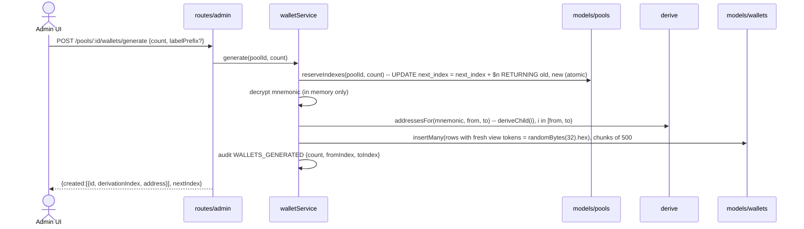
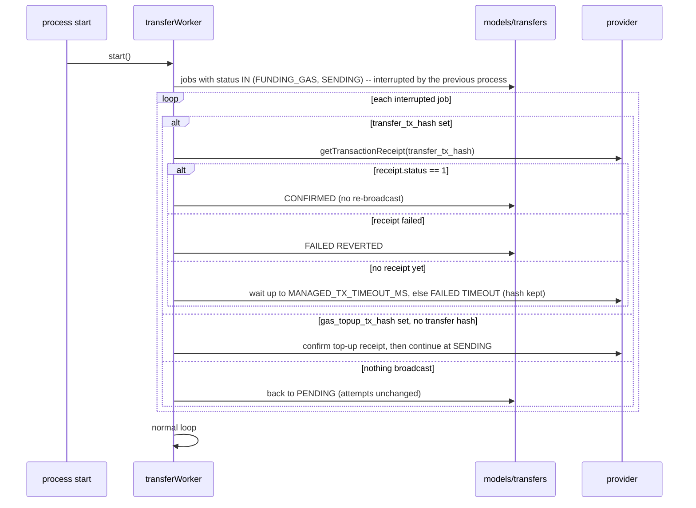

# Managed Wallets — Architecture

Source of truth for scope: `docs/MANAGED_WALLETS_SPEC.md`. This document fixes the module layout, the runtime sequences, and the failure codes that every node builds against.

## 1. Module map

Everything new lives under `backend/src/managed/` and is mounted only when `MANAGED_WALLETS_ENABLED=true`.

```
backend/
  migrations/
    0000_baseline.sql                 documentation of the pre-existing schema (never applied)
    0001_managed_wallets.sql          applied by src/migrate.ts; idempotent
  src/
    migrate.ts                        runner: applies migrations/*.sql in order, records schema_migrations   (N2)
    lib/password.ts                   hashPassword + verifyPassword shared with routes/auth.ts               (N5)
    managed/
      types.ts                        shared API payload types (copied to frontend/src/lib/managedTypes.ts) (N1)
      index.ts                        mountManagedWallets(app), startManagedWorkers(), stopManagedWorkers() (N5)
      keyVault.ts                     AES-256-GCM encrypt/decrypt of pool mnemonics                          (N2)
      derive.ts                       HD derivation: account node, master (0), child (i≥1)                   (N2)
      redact.ts                       masks mnemonics / keys / ciphertext in any logged value                (N2)
      audit.ts                        recordManagedAudit (never throws)                                      (N2)
      models/
        pools.ts wallets.ts tokens.ts balances.ts deposits.ts transfers.ts indexerState.ts audits.ts     (N2)
      chain/
        ports.ts                      interfaces the chain layer needs (vault, models subset, clock, logger)  (N3)
        rpc.ts                        providerFor(network), withFallback(fn)                                 (N3)
        multicall.ts                  Multicall3 getEthBalances / getTokenBalances                            (N3)
        fees.ts                       resolveGasPrice with floor/ceiling                                      (N3)
        indexer.ts                    Transfer-log scanner, token discovery, deposit insert                   (N3)
        balances.ts                   refreshPairs / refreshAll / refreshMaster                               (N3)
        transferPlanner.ts            pure planner (gas, top-up, sweep math)                                  (N3)
        transferWorker.ts             durable job loop: FUNDING_GAS → SENDING → CONFIRMED                     (N3)
      service/
        poolService.ts walletService.ts transferService.ts treasuryService.ts tokenService.ts            (N5)
      middleware/
        featureFlag.ts keyVaultGuard.ts requireRecentReauth.ts viewRateLimit.ts                           (N5)
      routes/
        admin.ts                      /api/admin/managed/*                                                   (N5)
        view.ts                       /api/view/:viewToken                                                   (N5)
  scripts/managed/
    gen-key.ts                        prints a fresh base64 32-byte key                                      (N2)
    testnet-e2e.ts                    manual end-to-end on bscTestnet                                        (N8)
  test/managed/                       vitest suites                                                          (N2, N3, N5, N8)

frontend/src/
  lib/managedTypes.ts                 copy of backend types                                                  (N1)
  lib/managedApi.mock.ts              typed fixtures used by N4 before the API exists                        (N4)
  lib/managedApi.ts                   real client + useManagedEnabled()                                      (N6)
  pages/admin/managed/
    routes.tsx PoolsPage.tsx PoolDetailPage.tsx TreasuryPage.tsx TransferJobsPage.tsx ManagedSettingsPage.tsx (N4)
  pages/WalletViewPage.tsx            public holder page                                                     (N6)
  components/managed/                 PoolCard, ManagedWalletTable, BalanceChips, TokenBadge, TransferDialog,
                                      SweepDialog, JobStatusDrawer, ReauthDialog, ViewLinkButton, DepositFeed,
                                      IndexerStatusBadge, RevealMnemonicModal (N4) and QrCode (N6)
```

Dependency direction: `routes → service → (models | chain)`; `chain → ports` (never imports models directly, N5 injects them); `models → lib/postgres`. Nothing under `managed/` imports from `routes/`, `lib/runner.ts`, or `scripts/`.

## 2. Lifecycle

```mermaid
sequenceDiagram
  participant Boot as src/index.ts
  participant M as managed/index.ts
  participant Idx as chain/indexer
  participant W as chain/transferWorker
  Boot->>M: mountManagedWallets(app) [only if MANAGED_WALLETS_ENABLED=true]
  M->>M: check WALLET_ENCRYPTION_KEY (keyVault available?)
  M->>M: app.use('/api/admin/managed', adminRouter); app.use('/api/view', viewRouter)
  Boot->>M: startManagedWorkers() after listen
  M->>Idx: start() if MANAGED_INDEXER_ENABLED
  M->>W: start()
  Note over Boot: on SIGTERM
  Boot->>M: await stopManagedWorkers()
  M->>Idx: stop() (clear timer, await in-flight scan)
  M->>W: stop() (finish current job, no new pick)
```

Guard order on every admin route: `requireAdmin → featureFlag → keyVaultGuard (→ requireRecentReauth on sensitive routes)`.

## 3. Sequences

### 3.1 Create pool

```mermaid
sequenceDiagram
  actor A as Admin UI
  participant R as routes/admin
  participant S as poolService
  participant D as derive
  participant V as keyVault
  participant P as models/pools
  A->>R: POST /reauth {password}
  R-->>A: {ok, validUntil}
  A->>R: POST /pools {name, network, mnemonic?}
  R->>S: createPool(userId, body)
  S->>D: mnemonic ?? generate(); validate BIP-39
  S->>D: masterAddress = accountNode(m).deriveChild(0).address
  S->>V: encryptSecret(m, aad=poolId)
  S->>P: insert {masterAddress, ciphertext, iv, tag, keyVersion, nextIndex:1}
  S->>S: audit POOL_CREATED {network, masterAddress}
  R-->>A: {pool, masterAddress}  (mnemonic never echoed)
  A->>R: POST /pools/:id/reveal-mnemonic (reauth)
  R->>S: reveal → V.decryptSecret → audit MNEMONIC_REVEALED
  R-->>A: {mnemonic} shown once in RevealMnemonicModal
```

### 3.2 Generate wallets



Limit: `count ≤ MANAGED_MAX_WALLETS_PER_POOL − (nextIndex − 1)`, else `400 POOL_LIMIT_REACHED`.

### 3.3 Indexer cycle

```mermaid
sequenceDiagram
  participant T as timer (MANAGED_INDEXER_INTERVAL_MS)
  participant I as chain/indexer
  participant RPC as rpc/withFallback
  participant Tk as models/tokens
  participant Dp as models/deposits
  participant B as chain/balances
  participant St as models/indexerState
  T->>I: runOnce(network) for each network with an ACTIVE pool
  I->>RPC: latest = getBlockNumber(); head = latest - CONFIRMATIONS
  I->>St: from = last_scanned_block + 1 (first run: head - BLOCK_CHUNK)
  loop block chunks [from, head] step BLOCK_CHUNK
    loop address chunks of ADDRESS_CHUNK managed addresses
      I->>RPC: getLogs({fromBlock,toBlock,topics:[TRANSFER_SIG,null,[paddedAddrs]]})
      I->>Tk: upsertDiscovered(token) on first sight (symbol/name/decimals via try/catch)
      I->>Dp: insertManyIgnoreDuplicates(deposits)  -- unique(tx_hash, log_index)
      I->>I: dirty.add(walletId, token)
    end
    I->>St: upsert(last_scanned_block = toBlock)
  end
  I->>B: refreshPairs(dirty)
  alt every MANAGED_FULL_REFRESH_MS
    I->>B: refreshAll(network) + refreshMaster(pool) for each pool
  end
  I->>St: last_run_at = now, last_error = null
  Note over I: on error: backoff, rotate provider, St.last_error = message (redacted)
```

Native BNB deposits produce no log: they show up through `refreshAll` as balance changes only.

### 3.4 Transfer with gas top-up

```mermaid
sequenceDiagram
  actor A as Admin UI
  participant R as routes/admin
  participant TS as transferService
  participant Pl as transferPlanner (pure)
  participant Tr as models/transfers
  participant W as transferWorker
  participant V as keyVault
  participant C as chain (provider)
  A->>R: POST /transfers/plan {walletId, toAddress, asset, amount|sweepAll}
  R->>TS: plan() → reads balances, fees, estimateGas → Pl.plan(input)
  R-->>A: {plan: ok/topUpWei...} shown in review step
  A->>R: POST /transfers {..., idempotencyKey} (reauth)
  R->>Tr: create(status=PENDING)  -- unique idempotency_key: duplicate → return existing job (200)
  R-->>A: {job}
  W->>Tr: pickNextPending() FOR UPDATE SKIP LOCKED
  W->>V: decrypt pool mnemonic → master & child signers (memory only)
  W->>C: fresh balances + fee data → Pl.plan(); reject → FAILED {code}
  alt topUpWei > 0
    W->>Tr: status=FUNDING_GAS
    W->>C: master.sendTransaction({to: child, value: topUpWei}) ; wait(1)
    W->>Tr: gas_topup_tx_hash
  end
  W->>Tr: status=SENDING
  W->>C: child.sendTransaction(transfer tx) ; wait(1)
  W->>Tr: transfer_tx_hash, status=CONFIRMED, confirmed_at
  W->>W: refresh balances (child, destination if managed, master); audit TRANSFER_CONFIRMED
  A->>R: GET /transfers/:id (poll 5 s)
```

### 3.5 Sweep batch

```mermaid
sequenceDiagram
  actor A as Admin UI
  participant R as routes/admin
  participant TS as transferService
  participant Bl as models/balances
  participant Tr as models/transfers
  A->>R: POST /transfers/sweep {poolId, walletIds|ALL, assets|ALL, toAddress?, idempotencyKey} (reauth)
  R->>TS: sweep()
  TS->>Bl: pairs = non-zero (wallet, asset) for selected wallets/assets, hidden tokens excluded
  TS->>Tr: createBatch(batchId, one job per pair, sweep_all=true, idempotency_key = key + ':' + walletId + ':' + asset)
  TS->>TS: audit SWEEP_REQUESTED {batchId, jobs, skipped}
  R-->>A: {batchId, jobs, skipped}
  Note over Tr: worker drains jobs sequentially; failures isolated per job
  A->>R: GET /transfers?batchId= (poll) → byStatus counts
```

Native sweep-all jobs compute `amount = childBnb − gasCost` at execution time; token sweep-all uses `balanceOf` at execution time.

### 3.6 Restart recovery



Before any broadcast the worker always re-checks stored hashes, so a crash between "broadcast" and "store hash" is the only double-send window; it is closed by broadcasting with a deterministic nonce read right before signing and by storing the hash immediately after `sendTransaction` resolves (before `wait`).

## 4. Failure modes and codes

| Where | Code | Meaning | Handling |
|---|---|---|---|
| any managed route | `FEATURE_DISABLED` | flag off | route not mounted → plain 404 |
| any managed route | `KEY_VAULT_UNAVAILABLE` | `WALLET_ENCRYPTION_KEY` missing/invalid | 503; app otherwise healthy |
| any managed route | `NOT_MIGRATED` | tables missing (42P01) | 503 with runbook hint |
| sensitive routes | `REAUTH_REQUIRED` | no re-auth in last 10 min | 401 |
| POST /pools | `INVALID_MNEMONIC` | import phrase fails BIP-39 check | 400 |
| generate | `POOL_LIMIT_REACHED` / `POOL_ARCHIVED` | cap or archived | 400 / 409 |
| planner | `NOTHING_TO_SWEEP` | native balance ≤ gas cost, or token balance 0 | plan ok=false |
| planner | `INSUFFICIENT_TOKEN_BALANCE` | amount > balanceOf | plan ok=false |
| planner | `INSUFFICIENT_NATIVE_FOR_AMOUNT` | native amount + gas > child BNB | plan ok=false |
| planner | `MASTER_INSUFFICIENT_BNB` | master BNB < topUp + reserve | plan ok=false |
| planner | `GAS_LIMIT_EXCEEDED` | estimate × 1.2 > MANAGED_MAX_GAS_LIMIT | plan ok=false |
| planner | `INVALID_DESTINATION` | not an address, zero address, or the child itself | plan ok=false |
| worker | `BROADCAST_FAILED` | provider rejected tx (nonce, underpriced, …) | FAILED, retry allowed |
| worker | `REVERTED` | receipt.status 0 | FAILED, retry allowed after investigation |
| worker | `TIMEOUT` | not mined within MANAGED_TX_TIMEOUT_MS | FAILED, hash kept |
| worker | `MAX_ATTEMPTS` | attempts ≥ MANAGED_MAX_ATTEMPTS | FAILED, retry refused |
| indexer | (status field) | RPC errors | backoff, `last_error`, lag shown in UI |
| view | 404 | unknown/disabled wallet or archived pool | generic not found |
| view | 429 | rate limit | `express-rate-limit` default body |

## 5. Security invariants (checked by N7)

1. Mnemonic plaintext exists only inside `poolService.createPool/reveal` and `transferWorker` locals.
2. `redact()` wraps every logger call in `managed/`; unit test proves masking.
3. No API response includes `mnemonic_*`, child private keys, or `view_token` except `GET /wallets/:id` (admin) and the rotate endpoint.
4. Public view response contains no pool id, pool name, derivation index, or other wallets.
5. All dynamic SQL uses parameter placeholders; search uses `ILIKE $n` with escaped `%`/`_`.
6. Every admin route checks that the pool belongs to an ADMIN-visible scope: pools are admin-global (any ADMIN can see any pool) in v1; `owner_user_id` is recorded for audit only.
